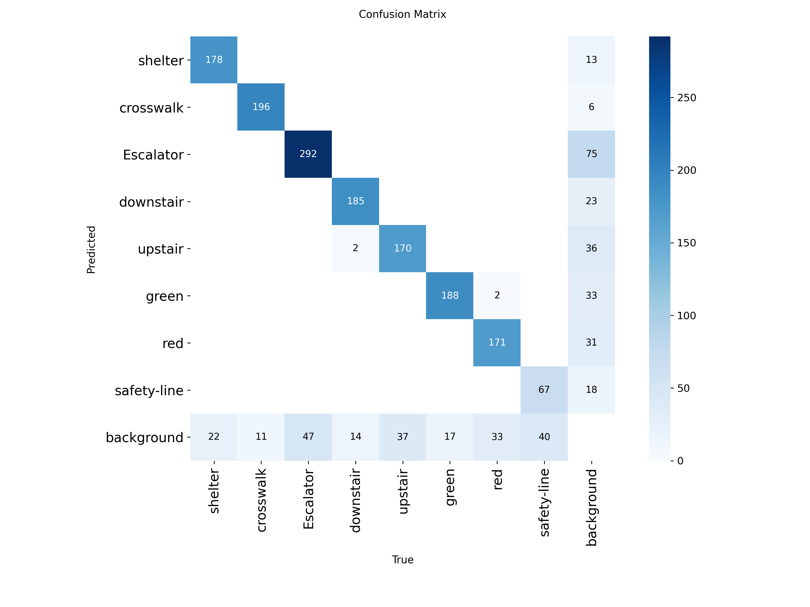

# SmartCane — visual navigation aid for blind and low-vision users

A YOLOv8n detector that spots eight objects that matter when you are moving through
public transport on your own — bus shelters, crosswalks, escalators, stairs, pedestrian
traffic lights and the yellow line at the edge of a metro platform — and says what it
sees out loud in Persian, together with which way to go.

The idea is not to replace a white cane. It is to add the piece a cane cannot give you:
knowing what is a few metres ahead and roughly where it sits in front of you.



## What it detects

| Class | Meaning |
| --- | --- |
| `shelter` | Bus shelter / stop |
| `crosswalk` | Zebra crossing |
| `Escalator` | Escalator |
| `downstair` | Stairs going down |
| `upstair` | Stairs going up |
| `green` | Pedestrian light, green |
| `red` | Pedestrian light, red |
| `safety-line` | Yellow line at the platform edge |

## How the spoken cue is built

Each detection is placed in the left, centre or right third of the frame, and the class
plus that position decide the sentence. For example, a crosswalk on the left becomes
*«خط عابر پیاده نزدیک است. کمی به چپ بروید»* — "a crosswalk is near, go a little left".

Traffic lights ignore position and just report the colour. The platform edge line is the
one case where the advice is inverted: it is a hazard, so the user is told to move *away*
from it ("you are near the yellow platform edge line, step back a little").

Speech is generated with [`persianttsfarsi`](https://pypi.org/project/persianttsfarsi/).

## Running the demo

```bash
pip install -r requirements.txt

python demo.py --source path/to/image.jpg
```

The weights in `models/` are loaded by default. `--source` also accepts a directory, in
which case one image is picked at random — handy for sanity-checking on a test split.
One `.mp3` is written per detection into `output/`, and `--save-annotated` also writes the
image with the boxes drawn on it.

## Layout

```
demo.py                 detection -> Persian cue -> audio
models/                 trained weights
notebooks/
  01_dataset_preparation.ipynb   collecting, de-duplicating and rebalancing the sources
  02_training_and_evaluation.ipynb   merging, augmenting, training, evaluation
assets/                 figures used in this README
```

Both notebooks were written for Google Colab and mount Google Drive, so the paths in them
point at `/content`. The dataset-prep notebook downloads from Roboflow and expects an API
key in the environment:

```bash
export ROBOFLOW_API_KEY=your_key
```

## Dataset

Eight Roboflow projects were pulled in, de-duplicated by file hash, filtered down to the
classes needed, then capped per class so no single class dominated. The merged set is
**7,676 train / 1,236 validation / 1,482 test** images before augmentation.

The combined dataset is on Google Drive:
**[SmartCane final dataset](https://drive.google.com/file/d/17kFBDpmrkDPdElNgwfM9HnmgKWnrjxUy/view?usp=sharing)**

Source projects on Roboflow Universe:

| Classes | Project |
| --- | --- |
| Crosswalk | [crosswalk-lqgin](https://universe.roboflow.com/saad-pif/crosswalk-lqgin-wkyy3/dataset/1) |
| Red / green pedestrian lights | [pedestrian-traffic-lights-final](https://universe.roboflow.com/saad-pif/pedestrian-traffic-lights-final-unr9q/dataset/1) |
| Bus shelter | [bus-stop-v3](https://universe.roboflow.com/saad-pif/bus-stop-v3-tkgii/dataset/1), [bus-shelter](https://universe.roboflow.com/saad-pif/bus-shelter-bqk7e/dataset/1) |
| Escalator, up/down stairs | [escalator-stairs](https://universe.roboflow.com/saad-pif/escalator-stairs-4wydv/dataset/1) |
| Platform edge line | [metro-project](https://universe.roboflow.com/saad-pif/metro-project-upiib/dataset/2), [platform-edge](https://universe.roboflow.com/saad-pif/platform-edge-58c97/dataset/2), [subway-objects](https://universe.roboflow.com/saad-pif/subway-objects-mbr5v/dataset/2) |

The platform-edge sources were polygon-annotated, so those labels are converted to
bounding boxes in `01_dataset_preparation.ipynb` before merging.

## Training

YOLOv8n, starting from the COCO-pretrained checkpoint, 640×640, batch 8. The backbone was
frozen and only the neck and detection head (`model.15` onward) were trained, which keeps
the run cheap and was enough given the dataset size. Training ran in repeated 10-epoch
passes on a Colab GPU, each one resuming from the previous best checkpoint.

Augmentation, via Albumentations: horizontal flip (p=0.5), rotation up to ±15° (p=0.4),
brightness/contrast jitter (p=0.3), blur (p=0.2) and CLAHE (p=0.1).

## Results

On the held-out test split:

| Class | Images | Instances | P | R | mAP@50 | mAP@50-95 |
| --- | --- | --- | --- | --- | --- | --- |
| **all** | 1482 | 1672 | 0.872 | 0.827 | **0.877** | 0.546 |
| shelter | 200 | 200 | 0.940 | 0.875 | 0.938 | 0.657 |
| crosswalk | 200 | 207 | 0.972 | 0.942 | 0.961 | 0.835 |
| Escalator | 200 | 339 | 0.806 | 0.846 | 0.861 | 0.556 |
| downstair | 200 | 201 | 0.884 | 0.871 | 0.917 | 0.489 |
| upstair | 200 | 207 | 0.837 | 0.763 | 0.831 | 0.463 |
| green | 200 | 205 | 0.857 | 0.898 | 0.914 | 0.419 |
| red | 200 | 206 | 0.860 | 0.801 | 0.865 | 0.386 |
| safety-line | 82 | 107 | 0.822 | 0.617 | 0.729 | 0.566 |

Crosswalks and shelters are the easiest — they are large and visually distinct. Up-stairs
and the platform edge line are the weakest: stairs are easily confused with escalators
from a pedestrian viewpoint, and the edge line had by far the smallest share of the data
(82 test images against 200 for everything else), which shows up directly in its recall.

The mAP@50-95 numbers are much lower than mAP@50 across the board. For traffic lights
especially this is expected — they are small objects, so a few pixels of box error cost a
lot at tight IoU thresholds. For this use case the loose threshold is the one that
matters: the cue only needs the right class and roughly the right third of the frame.

Timings from the Colab evaluation run were 8.0 ms preprocessing, 259.9 ms inference and
0.6 ms postprocessing per image.

## Known limitations

- There is no distance estimate. "Near" is inferred from the class being detected at all,
  not from how far away the object actually is.
- Each frame is handled independently, so cues can flicker between frames.
- Running on a Raspberry Pi 5 was the original target but was never tested; the timings
  above are from Colab, not from the intended hardware.
- Horizontal position is a crude left/centre/right split of the frame, which assumes the
  camera is pointing roughly where the user is walking.

## Possible next steps

Object tracking across frames would stabilise the cues, and a depth sensor or a stereo
pair would turn "near" into an actual distance. More data for `safety-line` and `upstair`
is the cheapest available accuracy win. Haptic feedback alongside the audio would also
help in noisy stations, where speech is the least reliable channel.
